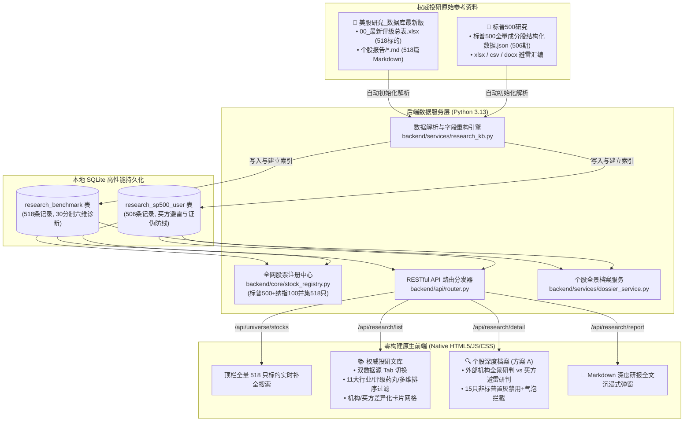
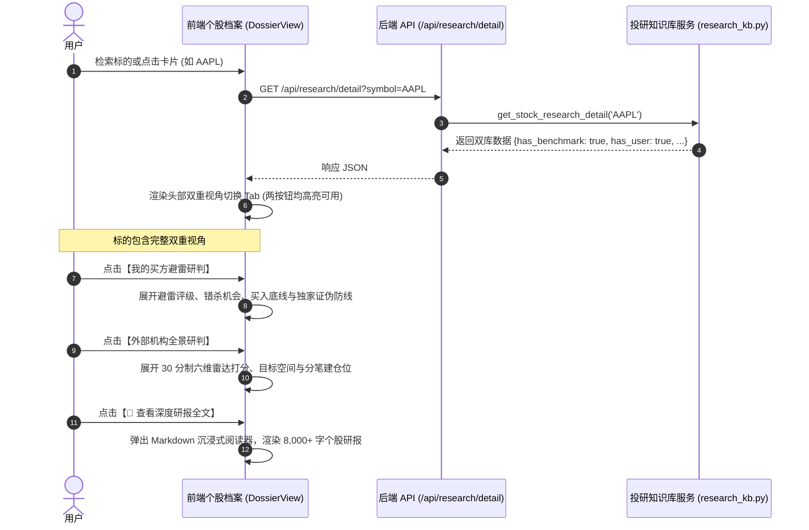

# 权威投研文库与双库交叉研判系统 · 技术架构与设计文档 (Design Document)

> **版本**：v2.1  
> **状态**：已落地交付 / 生产就绪  
> **归属工程**：`AI Stock Workbench 2.0`  
> **核心数据源**：
> 1. `美股研究_数据库最新版`（外部机构投研库，518 只核心标的 + 518 篇 Markdown 深度研报全文，涵盖标普500与纳斯达克100特选）
> 2. `标普500研究`（自研买方避雷库，506 期全景跟踪，聚焦标普500成分股）

---

## 1. 业务背景与系统愿景

### 1.1 业务诉求
传统的量化与基本面选股系统往往存在两大局限：
1. **单一数据视角容易盲信**：仅依赖量化因子或单一卖方评级，容易忽略买方风控关注的估值脱节、证伪防线与错杀机会；
2. **定性分析与定量数据割裂**：用户持有大量深度行业与个股 Markdown 研报，但在查看行情与技术指标时无法即时调阅，造成投研断层。

本次升级的核心目标是：**将两套异构的权威美股研究资产无缝导入系统，完成结构化清洗、统一字段重构，建立双数据源 Tab 切换检索机制，并实现个股档案中的双重视角（外部机构全景研判 vs 买方避雷研判）秒级切换对照**。

### 1.2 核心设计约束与决策
- **默认检索池**：检索项默认取 **标普500 + 纳斯达克100 并集（共 518 只股票）**，顶栏与首页搜索即时补全。
- **文库默认展示**：权威投研文库默认展示第一个文件夹（**美股全景投研库 · 518只标的**），支持平滑切换至第二个文件夹（**标普500避雷研究库**）。
- **个股档案呈现模式（方案 A）**：个股档案页顶部提供快捷视角切换面板（“外部机构全景研判” vs “我的买方避雷研判”），随时对照两份不同的操作计划与评级。
- **纳指 15 只非标普标的交互**：对于属于纳指 100 但未被标普 500 收录的 15 只特选标的（如 `ARM`, `ASML`, `PDD`, `MSTR`, `MELI`, `RKLB` 等），在个股档案中将切换至“我的买方避雷研判”按钮**置灰禁用（点不动）**；当用户鼠标悬停或点击时，明确展示气泡提示：**“该标的属于纳指100非标普成分股，本库仅收录标普500”**。
- **研报弹窗阅读**：支持 518 篇 Markdown 研报全文弹窗秒级渲染阅读，无需加载重型前端打包依赖。

---

## 2. 总体架构与数据流图 (Architecture & Data Flow)



---

## 3. 数据库表结构设计 (Database Schema)

系统在 `data/stock_dossiers.sqlite` 中维护两张核心数据表，均建有 `symbol` 和 `ticker` 唯一索引以保障毫秒级查询。

### 3.1 外部机构全景研判库 (`research_benchmark`)

| 字段名 | 类型 | 说明 | 示例 |
|---|---|---|---|
| `symbol` | TEXT PRIMARY KEY | 股票唯一标识代码 | `'AAPL.US'` |
| `ticker` | TEXT | 股票代码（纯大写） | `'AAPL'` |
| `name_cn` | TEXT | 公司中文全称 | `'苹果公司'` |
| `name_en` | TEXT | 公司英文名 | `'Apple Inc.'` |
| `sector` | TEXT | 所属行业板块 | `'信息技术'` |
| `sub_industry` | TEXT | 细分子行业 | `'Consumer Electronics'` |
| `index_code` | TEXT | 所属指数体系 | `'SP500'` / `'NDX100_EX_SP'` |
| `price` | REAL | 基准收盘价格 ($) | `262.24` |
| `target_price` | REAL | 机构目标价 ($) | `265.00` |
| `target_upside`| REAL | 预期上涨空间 (比率) | `0.0105` (即 +1.05%) |
| `rating` | TEXT | 机构综合评级 | `'建议买入'` / `'逢低关注'` / `'持有观望'` / `'不建议买入'` |
| `total_score` | REAL | **30分制六维质地量化总分** | `26.0` |
| `score_moat` | REAL | 护城河得分 (0~5) | `5.0` |
| `score_growth` | REAL | 成长爆发得分 (0~5) | `4.0` |
| `score_financial`| REAL | 财务健康得分 (0~5) | `5.0` |
| `score_return` | REAL | 股东回报得分 (0~5) | `4.0` |
| `score_valuation`| REAL | 估值安全得分 (0~5) | `3.0` |
| `score_catalyst` | REAL | 催化动量得分 (0~5) | `5.0` |
| `ttm_pe` | REAL | 滚动市盈率 (TTM) | `33.8` |
| `fcf_yield` | REAL | 自由现金流收益率 | `0.038` (即 3.8%) |
| `action_plan` | TEXT | 机构分步建仓规划操作位 | `'第1笔: $250买入底仓; 第2笔: $235加仓...'` |
| `conclusion` | TEXT | 研报核心结论摘要 | `'闭环生态高壁垒，AI终端换机周期的核心标的'` |
| `has_report` | INTEGER | 是否匹配 518 篇 Markdown 研报 | `1` |

### 3.2 标普500买方避雷研究库 (`research_sp500_user`)

| 字段名 | 类型 | 说明 | 示例 |
|---|---|---|---|
| `id` | INTEGER PRIMARY KEY | 自增主键序号 | `3` |
| `symbol` | TEXT | 股票代码（带后缀） | `'AAPL.US'` |
| `ticker` | TEXT | 股票代码 | `'AAPL'` |
| `company_name` | TEXT | 研判记录公司名 | `'Apple Inc.'` |
| `sector` | TEXT | 行业分类与业务定位 | `'信息技术 / 消费电子与软件服务'` |
| `round` | TEXT | 历史追踪轮次 | `'第1期'` |
| `rating` | TEXT | **独家买方四级评级** | `'高估观望'` / `'优质低估'` / `'周期等待'` / `'坚决回避'` |
| `price` | REAL | 研判基准价格 ($) | `345.71` |
| `valuation_pe` | TEXT | **估值水位与历史分位分析** | `'PE达39.8倍，处于近5年历史分位数95%极高位...'` |
| `moat_and_momentum` | TEXT | 商业壁垒与核心动能 | `'全球活跃设备超22亿台，iOS闭环转换成本极高...'` |
| `risks_and_mispricing`| TEXT | **错杀逻辑与核心风险分析** | `'估值与增速脱节，硬件增速仅个位数，市场按40倍PE打满预期'` |
| `action_plan` | TEXT | 买方建仓与止盈纪律 | `'场外坚决不建仓；场内于$345-$350逐步止盈；$280以下再考虑'` |
| `invalidation_trigger`| TEXT | **独家买方证伪防守触发线** | `'iPhone出货量连续两季下滑超5%；服务业务反垄断导致佣金下调'` |

---

## 4. 核心业务流程与交互机制

### 4.1 方案 A：个股档案双重视角对照

在查看任意标的（例如 `AAPL`）时，系统通过 `dossier["research_perspectives"]` 同时下发两套数据。用户可随时在“外部机构全景研判”与“我的买方避雷研判”之间自由切换，横向对比外部机构给出的 30 分制量化得分与自研买方的防守纪律。



### 4.2 纳指 100 非标普成分股拦截与置灰机制 (NDX Non-SP500 Constraint)

由于外部机构数据涵盖标普500与纳斯达克100特选，而自研避雷库严格聚焦标普500，存在 **15 只专属纳指成分股**（`ARM`, `ASML`, `PDD`, `MSTR`, `MELI`, `RKLB`, `ALAB`, `ALNY`, `CCEP`, `CRWV`, `FER`, `NBIS`, `SHOP`, `SPCX`, `TRI`）。

对上述标的，系统执行如下严格的交互约束：
1. **按钮禁用置灰**：`#btnPerspUser` 被赋予 `.btn-disabled` 样式（半透明度 45%，鼠标呈现 `not-allowed` 禁用指针）。
2. **点击坚决点不动**：点击事件被底层逻辑直接 `return` 拦截，绝不发生视角跳变。
3. **悬停与点击双重提醒**：
   - 鼠标悬停时，原生 `title` 浮层提示：`该标的属于纳指100非标普成分股，本库仅收录标普500`。
   - 鼠标点击时，屏幕正上方触发醒目的黄色发光 Toast 浮动警告条：`⚠️ 该标的属于纳指100非标普成分股，本库仅收录标普500`。

```mermaid
flowchart TD
    ClickUserBtn["用户点击【我的买方避雷研判】"] --> CheckStock{"检查标的成分归属<br/>persp.has_user"}
    CheckStock -->|has_user === true<br/>(标普500成分股)| SwitchOK["允许视角切换<br/>渲染买方避雷卡片与证伪红线"]
    CheckStock -->|has_user === false<br/>(15只纳指非标普成分股)| Intercept["阻止切换 (点不动)<br/>触发 showPerspectiveDisabledToast()<br/>提示：该标的属于纳指100非标普成分股，本库仅收录标普500"]
```

---

## 5. API 接口契约说明 (API Specification)

### 5.1 获取股票注册池（并集 518 只标的）
- **接口**：`GET /api/universe/stocks`
- **说明**：返回标普500与纳指100的 518 只股票全景索引，供前端搜索框即时补全。
- **返回示例**：
```json
{
  "ok": true,
  "stocks": [
    {
      "symbol": "AAPL.US",
      "ticker": "AAPL",
      "name_zh": "苹果公司",
      "name_en": "Apple Inc.",
      "sector": "信息技术",
      "universe_type": "SP500",
      "benchmark_rating": "建议买入",
      "target_upside": 0.0105
    },
    {
      "symbol": "ARM.US",
      "ticker": "ARM",
      "name_zh": "Arm 控股",
      "name_en": "Arm Holdings plc",
      "sector": "信息技术",
      "universe_type": "NDX100_EX_SP",
      "benchmark_rating": "逢低关注",
      "target_upside": 0.2459
    }
  ]
}
```

### 5.2 权威投研文库列表检索
- **接口**：`GET /api/research/list`
- **入参 Query Parameters**：
  - `source`: `'benchmark'`（默认）或 `'user'`
  - `query`: 搜索关键词（代码或公司名，如 `NVDA` 或 `英伟达`）
  - `sector`: 所属行业筛选（如 `信息技术`、`金融`）
  - `rating`: 评级过滤（如 `建议买入`、`优质低估`）
  - `sort_by`: 排序规则（`total_score_desc`, `upside_desc`, `pe_asc`, `ticker_asc`）
  - `page`: 当前页码（默认 `1`）
  - `page_size`: 每页大小（默认 `12`）
- **返回示例**：
```json
{
  "ok": true,
  "source": "benchmark",
  "total": 518,
  "page": 1,
  "page_size": 12,
  "total_pages": 44,
  "sectors": ["信息技术", "医疗保健", "金融", "可选消费", "工业", "..."],
  "rating_counts": {
    "建议买入": 155,
    "逢低关注": 277,
    "持有观望": 47,
    "不建议买入": 39
  },
  "items": [
    {
      "symbol": "AAPL.US",
      "ticker": "AAPL",
      "name_cn": "苹果公司",
      "rating": "建议买入",
      "total_score": 26.0,
      "target_price": 265.0,
      "target_upside": 0.0105,
      "ttm_pe": 33.8,
      "score_moat": 5.0,
      "score_growth": 4.0,
      "score_financial": 5.0,
      "score_return": 4.0,
      "score_valuation": 3.0,
      "score_catalyst": 5.0,
      "is_ndx_ex_sp": 0,
      "action_plan": "..."
    }
  ]
}
```

### 5.3 单股双重视角详情对照
- **接口**：`GET /api/research/detail?symbol=ARM`
- **返回示例**：
```json
{
  "ok": true,
  "ticker": "ARM",
  "symbol": "ARM.US",
  "has_benchmark": true,
  "has_user": false,
  "user_disabled_reason": "该标的属于纳指100非标普成分股，本库仅收录标普500",
  "benchmark": {
    "symbol": "ARM.US",
    "ticker": "ARM",
    "name_cn": "Arm 控股",
    "rating": "逢低关注",
    "total_score": 20.0,
    "target_price": 290.7,
    "target_upside": 0.2459,
    "ttm_pe": 240.5,
    "is_ndx_ex_sp": 1
  },
  "user": null,
  "has_report": true
}
```

### 5.4 个股 Markdown 深度研报全文调阅
- **接口**：`GET /api/research/report?symbol=AAPL`
- **说明**：调阅 `个股报告/AAPL.md` 原文全文，并附加机构评级与总分。
- **返回示例**：
```json
{
  "ok": true,
  "symbol": "AAPL.US",
  "ticker": "AAPL",
  "report_content": "# 苹果公司 (AAPL) 深度投资价值研报\n\n## 1. 核心投资逻辑...",
  "benchmark": {
    "rating": "建议买入",
    "total_score": 26.0
  }
}
```

---

## 6. 前端 UI/UX 与工程化实现

### 6.1 零构建原生架构
遵循全系统**极简零构建**原则（无 Webpack/Vite 捆绑开销，基于原生 ES6+、标准 CSS 变量与 HTML5）。
- **`web/index.html`**：声明语义化结构，包含 `researchSection`、`dossierPerspectivesPanel` 与 `researchReportModal`。
- **`web/styles.css`**：定义金融终端暗黑模式调色板、六维横向进度条动画、高光渐变药丸与毛玻璃模态弹窗。
- **`web/app.js`**：事件驱动架构，集成输入防抖、动态数据源切换、原生轻量 Markdown 渲染器与禁用拦截器。

### 6.2 轻量安全 Markdown 渲染器 (`renderMarkdown`)
在 `web/app.js` 中实现了原生的轻量解析引擎，支持：
- 标题层级解析 (`#` ~ `####`)
- 粗体 (`**text**`) 与斜体 (`*text*`)
- 引用块 (`> quote`) 与分割线 (`---`)
- 行内代码与标的标记 (`` `code` ``)
- **GFM 矩阵表格渲染**：自动识别 `| col1 | col2 |` 并排版为带表头的标准 HTML 表格。
- XSS 防御：在内容拼接前对 HTML 元字符（`&`, `<`, `>`）进行实体转义。

---

## 7. 质量保障与自动化测试

工程配备了完整的单元测试集与端到端集成测试，保障数据完整性与交互稳定性：

1. **测试用例文件**：[`tests/test_research_kb.py`](file:///Users/karma/Desktop/VScode/【2】其他/【2】AI选股/tests/test_research_kb.py)
   - `test_01_benchmark_table_count`：验证外部机构库精确收录 518 只标的。
   - `test_02_user_sp500_table_count`：验证自研避雷库精确收录 506 项有效记录。
   - `test_03_ndx_non_sp_disabling`：验证 15 只纳指非标普标的（ARM 等）`has_user == False` 且禁用提示文案 100% 准确。
   - `test_04_markdown_report_retrieval`：验证 518 篇 Markdown 研报全量映射且全文非空。
   - `test_05_stock_registry_518_universe`：验证全网股票注册池动态扩充为 518 只并集。
2. **全套自动化测试执行结果**：
   - 运行环境：Python 3.13 标准测试运行器
   - 执行命令：`python3 -m unittest discover -s tests`
   - 测试结果：**28 个测试用例全部通过（Ran 28 tests in 9.902s, OK）**，无断言失败，无资源泄漏警告。
3. **版本控制与开源交付**：
   - 全套代码、静态资源、参考资料原始数据及设计文档均已持久化至 Git，并已推送到 GitHub 远程仓库 `main` 分支。
